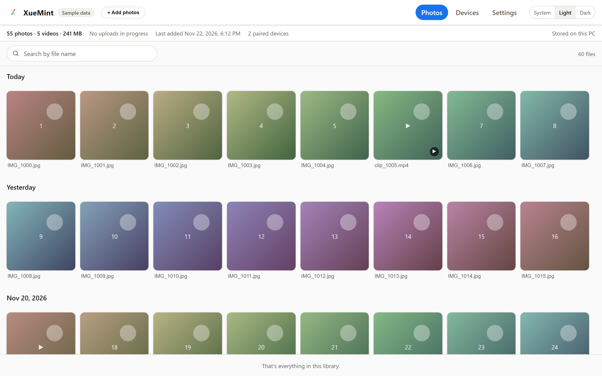
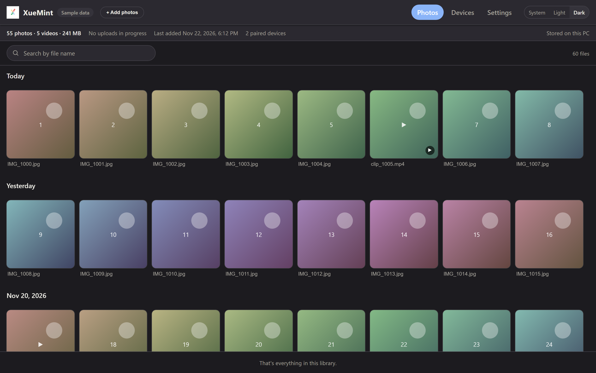
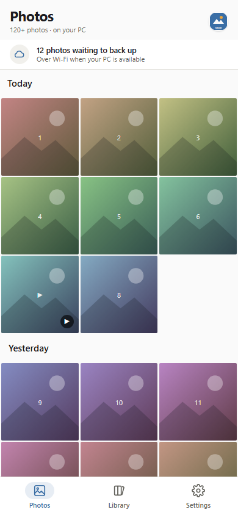
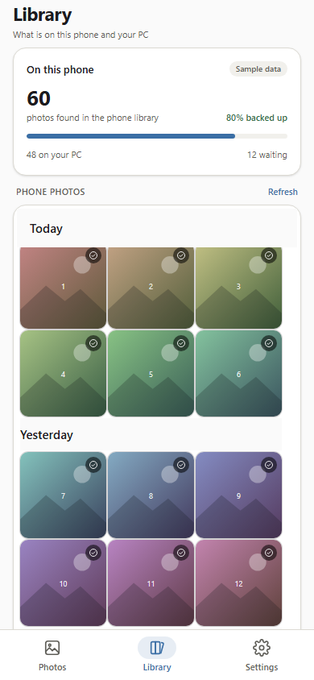
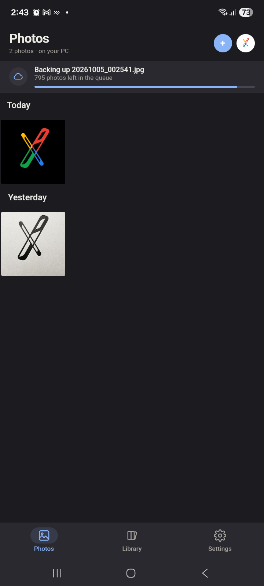
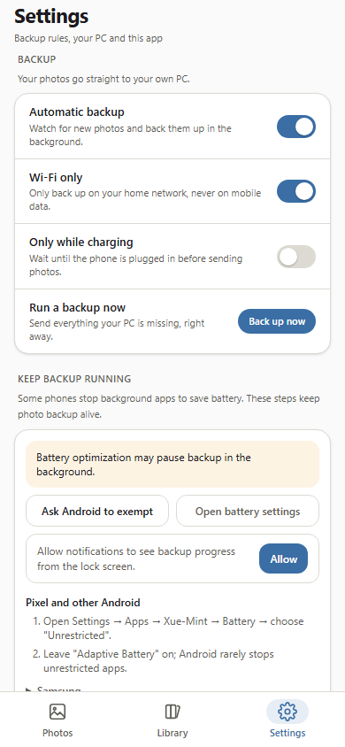

<div align="center">


# XueMint

**Your photos, on your PC.**

The Google Photos experience — timeline, viewer, automatic backup — with your own
PC as the cloud. No accounts, no subscriptions, no third-party servers.

[](LICENSE)
[](#getting-started)
[](#privacy)
[](#)

[Repository](https://github.com/Rehan-nawroz/Xue-mint) · [Report an issue](https://github.com/Rehan-nawroz/Xue-mint/issues)

</div>

---

## What is XueMint?

XueMint is a private photo backup system made of two apps that work together over
your own Wi-Fi:

- **The desktop app (Windows)** — installs like any normal program, runs quietly in
  the tray, and watches a photos folder on your PC. It serves a Google-Photos-style
  gallery in your browser and on your phone.
- **The mobile app (Android)** — pairs with your PC once by scanning a QR code, then
  automatically backs up your phone's photos whenever it is on the same Wi-Fi, and
  lets you browse everything stored on the PC.

Your photos live on your phone and your PC — and nowhere else.

## Why we made it

Cloud photo services give you a great experience at a hidden price: your personal
photos on someone else's servers, storage subscriptions that grow every year, and
accounts that can be locked or lost. Self-hosted alternatives are usually powerful
but complicated — Docker, ports, certificates, domain names.

XueMint takes the middle path we wished existed:

- **Simple** — install the desktop app, scan a QR code with your phone. That's the
  whole setup.
- **Private by design** — photos are transferred and stored only between devices
  you own, on your local network. There is no relay, no cloud account, no telemetry.
- **Yours** — no storage limits except your own disk, no subscription, no lock-in.
  The code is open under the Apache-2.0 license.

## Screenshots

| Desktop gallery (light) | Desktop gallery (dark) |
|:---:|:---:|
|  |  |

| Phone — timeline & backup | Phone — library with backup badges |
|:---:|:---:|
|  |  |

| Phone — backup in progress (real device) | Phone — settings & connection |
|:---:|:---:|
|  |  |

## Features

- **Automatic phone backup** — new photos upload in the background via WorkManager,
  with Wi-Fi-only and charge-only rules you control. If the PC is asleep or away,
  the phone queues everything and finishes when you're home.
- **Resumable, verified uploads** — uploads stream in chunks and survive app kills,
  network drops and PC restarts. Every file is checked by its BLAKE3 hash, so a
  corrupted transfer can never be stored.
- **Deduplication** — identical content is stored once, no matter how many times
  it's uploaded.
- **Google-Photos-style timeline** — date-grouped, virtualized grid that stays
  smooth with thousands of photos, sticky date headers, full-screen viewer with
  swipe, light and dark mode.
- **Format support** — JPEG, PNG, HEIC/HEIF (iPhone photos), camera RAW files
  (DNG, CR2, CR3, NEF, ARW and friends via their embedded previews), video
  thumbnails, and Live Photo pairs kept as a single item.
- **EXIF handling** — capture dates, GPS and orientation are read and used to place
  photos in the timeline; files without EXIF fall back to their file date.
- **Smart reconnection** — your phone finds the PC automatically on the network
  (mDNS) even after the PC's IP changes, and tells you plainly when a Wi-Fi network
  blocks device-to-device traffic.
- **Optional mirror folder** — keep a second copy of the PC library on an external
  drive; XueMint backfills it when the drive is connected.
- **Pairing that can't be spoofed** — the QR code carries the PC's TLS certificate
  fingerprint, which the phone verifies on every connection. A rogue device on the
  same network is refused.
- **Factory reset** — one tap wipes the PC index and the phone's engine data while
  never touching the actual photos in your phone gallery.

## Privacy

- Photos are transferred over your local network only, with **TLS and a pinned
  certificate fingerprint** — the phone refuses any machine whose certificate does
  not match the one it paired with.
- The phone stores its pairing credential **encrypted with an Android Keystore
  key**; it never touches disk in plain text and never appears in logs.
- There is **no cloud service, no account, no analytics** — if both devices are
  offline, nothing happens and nothing leaks.
- Notifications show counts and status only, never photo names or content.

## Getting started

### What you need

| Device | Requirement |
|---|---|
| PC | Windows 10 or 11 with the WebView2 runtime (pre-installed on Windows 11) |
| Phone | Android 8.0+ (Android 13+ for backup notifications) |
| Network | Both devices on the same Wi-Fi, with device-to-device traffic allowed (home networks are fine; guest/office networks often block it) |

### 1. The desktop app

Download `XueMint_<version>_x64-setup.exe` from the
[Releases](https://github.com/Rehan-nawroz/Xue-mint/releases) page and run it —
it installs per-user, no administrator rights needed. On first run:

1. A setup window appears; click **Allow connections** so Windows Firewall lets
   your phone reach the PC on your private network.
2. XueMint starts with Windows automatically (you can turn this off in setup).
3. Choose your photos folder in the gallery's **Settings** page — files you drop
   there appear in the timeline automatically.
4. Click **Pair a phone** (tray menu or gallery) to show the QR code.

> Note: pre-release builds are not code-signed yet, so Windows SmartScreen may ask
> you to confirm the first launch.

### 2. The Android app

There is no Play Store listing — the app is built from source on your own machine
(which also keeps the toolchain fully offline and private):

1. Install **Node.js 22+**, **JDK 21** and **Android Studio** (with the Android SDK).
2. Clone the repository and run from its root:

   ```bash
   npm install
   npm run build          # builds the shared UI, web gallery, mobile web app
   npx cap sync android   # copies the web app into the Android project
   ```

3. Open the **`mobile/android`** folder (not the repo root) in Android Studio, let
   Gradle sync, then **Run** on your phone or **Build > Generate Signed APK** for a
   release build. Use **Gradle JDK 21** if Gradle asks for a JDK.
4. Install the APK on your phone and grant photo access when asked.

### 3. Pair

With the desktop app running, tap **Pair** in the phone app and scan the QR code
shown on the PC (or paste the code manually). The phone immediately verifies the
PC's certificate fingerprint, sends its public key, and stores an encrypted
credential — you only ever do this once.

From then on, the phone backs up automatically under its rules:

| Rule | Where | Default |
|---|---|---|
| Automatic backup | Phone → Settings | On |
| Wi-Fi only | Phone → Settings | On (never over mobile data) |
| Only while charging | Phone → Settings | Off |
| Delete removes | PC → Settings | Index entry only (file kept) |

If something stops backups on a Samsung/Xiaomi/OPPO/Huawei phone, the app's
**Settings → Keep backup running** screen walks you through that maker's battery
optimization settings.

## Building from source

```bash
# Prerequisites: Node.js 22+, Rust (stable), Windows GNU toolchain or MSVC for the desktop app
git clone https://github.com/Rehan-nawroz/Xue-mint.git
cd Xue-mint

npm install              # installs the npm workspace (shared, web, mobile, desktop)
npm run build            # builds all TypeScript packages
npm run desktop:build    # builds the Rust server + Tauri shell + NSIS installer
```

- The **server** (Rust + axum + SQLite) is developed in `server/`; run its tests
  with `cargo test`.
- The **web gallery** lives in `web/`, the **mobile app** in `mobile/`, and both
  consume the shared UI package in `shared/` (photo grid, viewer, theme).
- `npm test` runs the frontend test suites; each app also has Playwright and
  performance checks.

## Project structure

| Folder | What it is |
|---|---|
| `server/` | Rust server: pairing, uploads, dedupe, thumbnails, EXIF, timeline API, folder watcher |
| `desktop/` | Tauri 2 shell: tray, installer, sleep prevention, firewall prompt, mDNS |
| `web/` | The gallery web app served by the server (React + Vite) |
| `mobile/` | Android app: React UI + Capacitor + the native Kotlin backup engine |
| `shared/` | UI package shared by web and mobile: grid, viewer, empty states, theme |
| `assets/brand/` | The single source of truth for logos and brand colors |

## FAQ

**Is my data really private?**
Yes — photos move directly between your phone and your PC over your own Wi-Fi.
There is no server run by us, no account, and no analytics. The only network
traffic is between devices you own.

**Can I access my photos from outside my home?**
Not in this version. XueMint is intentionally local-network-only; remote access is
a planned future feature and will be opt-in.

**What happens if the PC is off when I take photos?**
The phone queues them and shows "PC not reachable — will back up when you're
home". Everything drains automatically once the PC is back.

**What happens if a backup is interrupted?**
Uploads resume exactly where they stopped — even after an app kill, a reboot or a
PC restart — and every finished file is hash-verified.

**Do duplicate photos get uploaded twice?**
No. Content is identified by its BLAKE3 hash; identical photos are stored once.

**Does deleting a photo on the phone delete it from the PC?**
No. Deleting from the phone app removes the photo from the PC's library index
(and optionally the file, per the PC's delete-behaviour setting); the copy in your
phone gallery is never touched.

## Roadmap

- iOS app with the same interface and native engine
- Optional remote access (tunnel-based), off by default
- Code-signed Windows installer for a fully quiet SmartScreen experience

## License

Released under the [Apache License 2.0](LICENSE) — Copyright 2026 Rehan-Nawroz.
You are free to use, modify and distribute this software under its terms.

---

<div align="center">

**XueMint** — because your memories deserve your own hardware.

</div>
